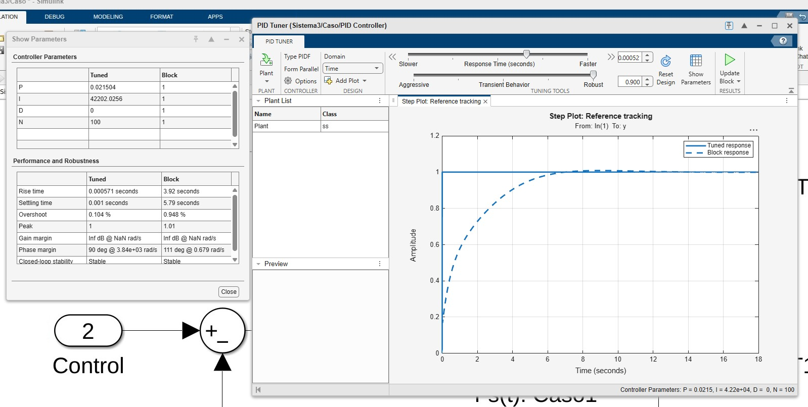
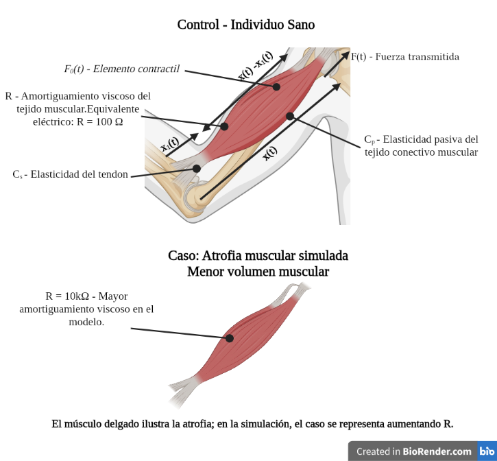
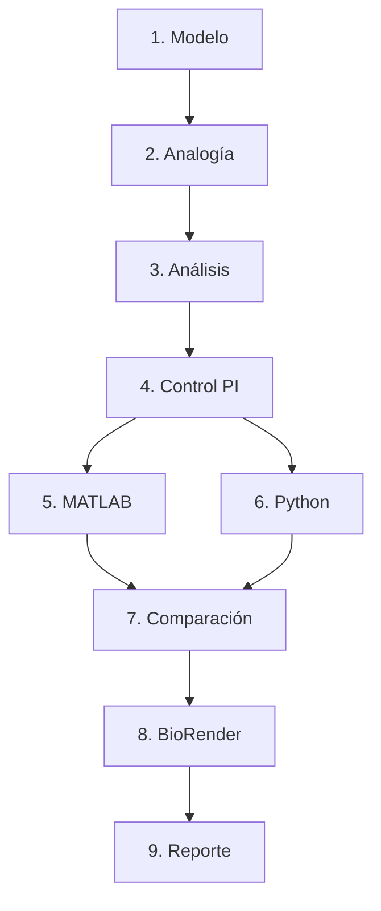

[](https://matlab.mathworks.com/open/github/v1?repo=Marcosnrj/MSFP2)

# Práctica 3 — Modelado y control del sistema musculoesquelético

Repositorio académico de la asignatura **Modelado de Sistemas Fisiológicos**, correspondiente al programa de **Ingeniería Biomédica** del Tecnológico Nacional de México / Instituto Tecnológico de Tijuana. Esta práctica integra la interpretación de un modelo mecánico, la analogía fuerza–voltaje, la formulación matemática, el análisis temporal y de estabilidad, la sintonización de un controlador y la simulación computacional.

El caso de estudio compara un **individuo sano (control)** con un **caso simulado de atrofia muscular (caso)**. Se analiza la respuesta de ambos sistemas ante una entrada de duración finita y se utiliza la salida del individuo sano como referencia para un controlador **PI** aplicado al caso.

**Docente:** Dr. Paul Antonio Valle Trujillo  
**Correo:** paul.valle@tectijuana.edu.mx  
**Departamento:** Ingeniería Eléctrica y Electrónica  
**Institución:** Tecnológico Nacional de México / Instituto Tecnológico de Tijuana  
**Asignatura:** Modelado de Sistemas Fisiológicos  
**Programa:** Ingeniería Biomédica  
**Estudiante:** Marcos Ancelmo Naranjo Rivera  
**Número de control:** 23212218  
**Correo institucional:** l23212218@tectijuana.edu.mx

**Repositorio de la asignatura:** https://github.com/DrPaulValle/MSF-IBF1020  
**Sede:** Blvd. Alberto Limón Padilla s/n, Tijuana, C. P. 22454, B. C., México.

---

<a id="contenido"></a>
## Contenido

1. [Resumen](#resumen)
2. [Competencia y objetivos](#objetivos)
3. [Relación con el temario](#temario)
4. [Modelo físico y analogía eléctrica](#analogia)
5. [Formulación matemática](#modelo)
6. [Análisis temporal y de estabilidad](#analisis)
7. [Señales de entrada y condiciones de simulación](#senales)
8. [Implementación en MATLAB y Simulink](#matlab)
9. [Control en lazo cerrado y sintonización PI](#pid)
10. [Reproducción en Python](#python)
11. [Diagrama biológico e interpretación fisiológica](#biologico)
12. [Resultados y verificación cruzada](#resultados)
13. [Flujo de trabajo](#flujo)
14. [Actividades del estudiante](#actividades)
15. [Estructura del repositorio](#estructura)
16. [Requisitos](#requisitos)
17. [Reproducibilidad y entregables](#reproducibilidad)
18. [Conclusiones](#conclusiones)
19. [Referencias](#referencias)

---

<a id="resumen"></a>
## Resumen

Se analizó un modelo mecánico formado por un elemento contráctil, un amortiguador y dos elementos elásticos. Se estableció su circuito eléctrico equivalente en el análisis matemático y se obtuvo una función de transferencia mediante superposición y transformada de Laplace. Se calculó el error en estado estacionario ante escalón unitario y se determinó la estabilidad de las condiciones control y caso.

Las funciones de transferencia se implementaron en Simulink y Python. La diferencia entre ambas condiciones se representó aumentando la resistencia de 100 Ω a 10 kΩ, manteniendo constantes las capacitancias y el factor de fuerza activa. Se sintonizó un controlador PI y se utilizó la salida del individuo sano como referencia. Las figuras muestran una respuesta más lenta del caso sin controlador y un seguimiento cercano de la referencia al incorporar el PI.

**Palabras clave:** sistema musculoesquelético; analogía fuerza–voltaje; atrofia muscular simulada; función de transferencia; control PI; MATLAB; Simulink; Python.

El desarrollo se realizó mediante experimentación **in silico**. El reporte relaciona las representaciones biológica, mecánica, eléctrica y computacional, e interpreta los resultados obtenidos en MATLAB/Simulink y Python.

[Volver al contenido](#contenido)

---

<a id="objetivos"></a>
## Competencia y objetivos

### Competencia a desarrollar

Modelar sistemas fisiológicos mediante analogías físicas, ecuaciones y funciones de transferencia, analizar su comportamiento dinámico y aplicar técnicas de control clásico mediante simulación computacional.

### Objetivo general

Comparar las respuestas del modelo musculoesquelético sano y del caso simulado de atrofia muscular, y evaluar un controlador PI que reduzca la diferencia entre ambas salidas.

### Objetivos específicos

- Identificar la función de los elementos contráctiles, viscosos y elásticos del modelo.
- Establecer el circuito equivalente mediante la analogía fuerza–voltaje.
- Obtener las funciones de transferencia del control y del caso.
- Analizar la ganancia estática, el error ante escalón y los polos de ambas condiciones.
- Simular las respuestas ante la misma señal de entrada en MATLAB/Simulink y Python.
- Registrar las ganancias del controlador y comparar el caso sin control y con PI.
- Relacionar el modelo con estructuras biológicas mediante un diagrama elaborado en BioRender.
- Documentar el procedimiento, las evidencias gráficas y las conclusiones en un repositorio académico.

[Volver al contenido](#contenido)

---

<a id="temario"></a>
## Relación con el temario

La práctica integra contenidos de tres unidades de la asignatura **Modelado de Sistemas Fisiológicos (IBF-1020)**:

| Unidad | Área | Contenidos aplicados |
|---|---|---|
| I | Sistemas de control retroalimentados | Respuesta temporal, polos, estabilidad, error y retroalimentación negativa |
| II | Modelado matemático | Analogía fuerza–voltaje, relaciones constitutivas, superposición y funciones de transferencia |
| III | Controladores | Control proporcional–integral, sintonización y comparación entre lazo abierto y cerrado |

Se relacionan conocimientos de fisiología, circuitos eléctricos, ecuaciones diferenciales y programación para interpretar el comportamiento de un modelo musculoesquelético.

[Volver al contenido](#contenido)

---

<a id="analogia"></a>
## Modelo físico y analogía eléctrica

El sistema incluye una fuerza activa $F_0(t)=\alpha F(t)$, una componente viscosa y elementos elásticos que representan de manera simplificada las propiedades del músculo y del tendón.

| Elemento | Interpretación en el modelo |
|---|---|
| $F_0(t)$ | Fuerza desarrollada por el elemento contráctil muscular |
| $F(t)$ | Fuerza de referencia del modelo, representada por la fuente de voltaje de entrada |
| $R$ | Amortiguamiento viscoso del tejido muscular |
| $C_p$ | Compliancia del elemento paralelo, asociada con estructuras musculares pasivas y tejido conectivo |
| $C_s$ | Compliancia del elemento en serie, asociada con el tendón |
| $x(t)$ | Desplazamiento total del sistema |
| $x_1(t)$ | Desplazamiento del elemento elástico en serie, según el modelo mecánico del instructivo |
| $x(t)-x_1(t)$ | Deformación relativa del amortiguador |

Las compliancias describen facilidad de deformación y corresponden al inverso de una rigidez lineal. El esquema biológico utiliza la palabra «elasticidad» para identificar las estructuras representadas.

### Analogía fuerza–voltaje

| Sistema mecánico | Equivalente eléctrico |
|---|---|
| Fuerza | Voltaje |
| Velocidad | Corriente |
| Desplazamiento | Carga eléctrica |
| Amortiguamiento viscoso | Resistencia |
| Compliancia | Capacitancia |

El circuito dibujado en el análisis matemático conecta una rama formada por la fuente $F_0$ y la resistencia $R$ en paralelo con $C_s$. Esta combinación se conecta en serie con $C_p$. La salida $F_s(t)$ se toma como el voltaje sobre $C_p$, respecto de la referencia eléctrica.

La topología eléctrica se obtiene a partir de las relaciones entre fuerzas y velocidades; no se copia directamente la disposición gráfica del modelo mecánico.

| Parámetro | Control | Caso |
|---|---:|---:|
| Amplitud de entrada | 1 V | 1 V |
| $\alpha$ | 0.25 | 0.25 |
| $C_s$ | 10 µF | 10 µF |
| $C_p$ | 100 µF | 100 µF |
| $R$ | 100 Ω | 10 kΩ |

Los valores corresponden al circuito equivalente. No constituyen una conversión numérica directa a parámetros fisiológicos sin factores de escala.

**Variable de salida utilizada:** el análisis y los programas entregados trabajan con $G(s)=F_s(s)/F(s)$ y muestran voltajes equivalentes a fuerzas. Para el capacitor paralelo, la carga equivalente al desplazamiento cumple $q_p=C_pF_s$. Esta relación conecta la variable eléctrica medida con la interpretación mecánica, considerando los factores de escala correspondientes.

[Volver al contenido](#contenido)

---

<a id="modelo"></a>
## Formulación matemática

### Ecuación del circuito

Considerando las polaridades del circuito del análisis, la corriente que llega a $C_p$ es la suma de las corrientes de las otras dos ramas:

$$
C_p\frac{dF_s}{dt}=\frac{F-F_0-F_s}{R}+C_s\frac{d(F-F_s)}{dt}.
$$

Al sustituir $F_0=\alpha F$ y reagrupar:

$$
R(C_p+C_s)\frac{dF_s}{dt}+F_s=RC_s\frac{dF}{dt}+(1-\alpha)F.
$$

Esta ecuación resume la dinámica de la función de transferencia implementada.

### Superposición

El desarrollo manuscrito obtiene por separado las contribuciones de las fuentes. Para el cálculo algebraico se trata cada fuente por separado y posteriormente se impone $F_0=\alpha F$:

$$
F_{s1}(s)=\frac{RC_ss+1}{R(C_p+C_s)s+1}F(s),
$$

$$
F_{s2}(s)=-\frac{\alpha}{R(C_p+C_s)s+1}F(s).
$$

Sumando ambas contribuciones y considerando condiciones iniciales nulas:

$$
\boxed{G(s)=\frac{F_s(s)}{F(s)}=\frac{RC_ss+1-\alpha}{R(C_p+C_s)s+1}.}
$$

### Funciones de transferencia utilizadas

Para el individuo sano:

$$
\boxed{G_{control}(s)=\frac{0.001s+0.75}{0.011s+1}.}
$$

Para el caso:

$$
\boxed{G_{caso}(s)=\frac{0.1s+0.75}{1.1s+1}.}
$$

Ambas funciones tienen un denominador de primer orden. En esta topología, la presencia de dos capacitores no implica dos estados dinámicos independientes.

[Consultar el análisis matemático manuscrito](Naranajo23212218_3analisismatematico.pdf).

### Forma integral equivalente

Integrando la ecuación dinámica con condiciones iniciales nulas se obtiene:

$$
R(C_p+C_s)F_s(t)+\int_0^t F_s(\tau)\,d\tau
=RC_sF(t)+(1-\alpha)\int_0^t F(\tau)\,d\tau.
$$

Esta expresión es equivalente a la función de transferencia y permite relacionar el almacenamiento de carga en los capacitores con la evolución de la salida. Se presenta como complemento de la formulación del modelo.

[Volver al contenido](#contenido)

---

<a id="analisis"></a>
## Análisis temporal y de estabilidad

### Error ante escalón unitario

Para una entrada escalón unitario $F(s)=1/s$, el teorema del valor final permite calcular:

$$
F_s(\infty)=\lim_{s\to0}sG(s)\frac{1}{s}=G(0)=1-\alpha=0.75.
$$

El error entre la entrada unitaria y la salida de la planta en lazo abierto es:

$$
e_{ss}=\lim_{s\to0}s\frac{1}{s}[1-G(s)]=\alpha=0.25.
$$

El resultado es igual para control y caso porque $R$ no modifica la ganancia estática. Este error se refiere a una entrada escalón mantenida, no al valor final de la respuesta al pulso utilizado en las gráficas. Tras finalizar el pulso, ambas salidas regresan a cero.

### Polos y constantes de tiempo

$$
\lambda=-\frac{1}{R(C_p+C_s)},\qquad \tau=R(C_p+C_s).
$$

| Condición | Polo (s⁻¹) | Constante de tiempo | Ganancia estática |
|---|---:|---:|---:|
| Control | −90.9091 | 0.011 s | 0.75 |
| Caso | −0.9091 | 1.1 s | 0.75 |

Los polos son reales negativos, por lo que ambas plantas son estables. El aumento de $R$ desplaza el polo hacia el origen y multiplica por 100 la constante de tiempo. El caso tarda más en responder y en regresar al equilibrio.

### Predicción de la respuesta temporal

A partir del polo y de la ganancia estática se espera que el individuo sano alcance rápidamente su nivel de salida, mientras que el caso presente una transición más lenta. Para un escalón unitario aplicado en el origen, la respuesta teórica es:

$$
F_s(t)=0.75-\left(0.75-\frac{1}{11}\right)e^{-t/\tau},\qquad t\geq0.
$$

La respuesta al pulso se obtiene como la diferencia de dos respuestas al escalón desplazadas a 1 y 2 s. Esto explica tanto el crecimiento durante la aplicación de la entrada como el retorno a cero al retirarla.

[Volver al contenido](#contenido)

---

<a id="senales"></a>
## Señales de entrada y condiciones de simulación

La señal efectivamente utilizada es un **pulso rectangular de amplitud 1 V y duración 1 s**, activo entre 1 y 2 segundos:

$$
F(t)=u(t-1)-u(t-2).
$$

La excitación se implementa como un pulso rectangular de duración finita. Esta definición corresponde a la señal utilizada en las figuras y en ambos programas.

| Configuración | Valor |
|---|---|
| Intervalo de simulación | 0–10 s |
| Condiciones iniciales | Nulas |
| Solver indicado por el cuaderno MATLAB | `ode15s` |
| Paso máximo indicado en MATLAB | 0.001 s |
| Paso del vector temporal en Python | 0.001 s |
| Número de muestras en Python | 10 001 |
| Pulse Generator de Simulink | Periodo 10 s, ancho 10 %, retardo 1 s |

En Python, el pulso se define mediante:

```python
u = np.zeros(N)
u[round(1/dt):round(2/dt)] = 1
```

[Volver al contenido](#contenido)

---

<a id="matlab"></a>
## Implementación en MATLAB y Simulink

El trabajo computacional se desarrolló en MATLAB Online y Simulink. El archivo `Sistema3.slx` contiene dos subsistemas principales:

- **Control:** función de transferencia del individuo sano.
- **Caso:** función de transferencia del caso en lazo abierto y una segunda instancia de la planta conectada al PI mediante retroalimentación negativa.

La salida del control se utiliza como referencia del lazo cerrado. Los bloques `To Workspace` guardan las señales:

| Señal | Contenido |
|---|---|
| `F` | Pulso de entrada |
| `Fsx` | Salida del individuo sano |
| `Fsy` | Salida del caso sin controlador |
| `FsPI` | Salida del caso con PI |
| `t` | Tiempo utilizado por el cuaderno para graficar |

El cuaderno ejecuta el modelo mediante:

```matlab
clc; clear; close all; warning('off','all')
open_system('Sistema3')
parameters.StopTime = '10';
parameters.Solver = 'ode15s';
parameters.MaxStep = '1e-3';
x = sim('Sistema3',parameters);

plotsignals(x.t,x.F,x.Fsx,x.Fsy,x.FsPI)
```

La función `plotsignals` compara las cuatro señales y exporta `Control_caso_matlab3.pdf`. El intervalo horizontal es de 0 a 10 s y el vertical de −0.1 a 1.1 V.

[Cuaderno MATLAB](Naranjo23212218_3.mlx) · [Cuaderno en PDF](Naranjo23212218_3.pdf) · [Modelo Simulink](Sistema3.slx).

### Organización de la simulación

| Representación | Función dentro del trabajo |
|---|---|
| Circuito equivalente y ecuaciones | Base del desarrollo analítico y de las funciones de transferencia |
| Función de transferencia del control | Generación de la respuesta sana utilizada como referencia |
| Función de transferencia del caso | Comparación de la dinámica con mayor resistencia |
| Caso con PI | Evaluación del seguimiento de la referencia sana |
| Cuaderno MATLAB | Ejecución del modelo, recuperación de señales y exportación de la figura |

La comparación utiliza la misma entrada y el mismo intervalo de simulación para que el efecto de modificar la resistencia pueda identificarse directamente.

[Volver al contenido](#contenido)

---

<a id="pid"></a>
## Control en lazo cerrado y sintonización PI

Se define el error de seguimiento de las señales implementadas como:

$$
e(t)=F_{s,control}(t)-F_{s,PI}(t).
$$

La salida del caso controlado se realimenta al sumador. La respuesta del caso en lazo abierto se conserva para comparación.

$$
K(s)=k_P+\frac{k_I}{s}.
$$

| Parámetro | Valor registrado en la captura y utilizado en Python |
|---|---:|
| $k_P$ | 0.021504 |
| $k_I$ | 42202.0256 |
| $k_D$ | 0 |

Aunque se utilizó el bloque `PID Controller`, el controlador final es **PI** porque la ganancia derivativa es cero. El archivo Simulink conserva mayor precisión: $k_P=0.0215035428234307$ y $k_I=42202.0255640197$.



La columna **Tuned** de la captura reporta:

| Indicador del PID Tuner | Valor |
|---|---:|
| Tiempo de subida | 0.000571 s |
| Tiempo de establecimiento | 0.001 s |
| Sobreimpulso | 0.104 % |
| Estabilidad en lazo cerrado | Estable |

Estos indicadores corresponden a la respuesta al escalón del lazo evaluado por PID Tuner. La columna **Tuned** representa el ajuste seleccionado, cuyas ganancias se encuentran incorporadas en el modelo Simulink.

La transferencia desde la referencia sana hasta la salida controlada es:

$$
T(s)=\frac{K(s)G_{caso}(s)}{1+K(s)G_{caso}(s)}.
$$

Usando las ganancias redondeadas de Python:

$$
T(s)=\frac{0.0021504s^2+4220.218688s+31651.5192}{1.1021504s^2+4221.218688s+31651.5192}.
$$

Sus polos calculados son aproximadamente −3822.4713 y −7.5129 s⁻¹, ambos estables. Para una referencia constante, $T(0)=1$, de modo que el error estacionario de seguimiento es nulo en el modelo ideal. Esto no implica igualdad instantánea de las señales durante los cambios de entrada.

### Relación entre la referencia y la entrada original

La referencia del lazo cerrado es la salida del modelo sano:

$$
F_{s,control}(s)=G_{control}(s)F(s).
$$

Por ello, la respuesta del caso con PI respecto de la entrada original cumple:

$$
F_{s,PI}(s)=T(s)G_{control}(s)F(s).
$$

El objetivo del lazo es seguir la respuesta sana. La acción proporcional responde al error presente y la acción integral acumula el error para reducir la diferencia sostenida entre la referencia y la salida.

[Volver al contenido](#contenido)

---

<a id="python"></a>
## Reproducción en Python

El archivo `Naranjo23212218_3.py` utiliza NumPy, python-control y Matplotlib. La función `sis(R, nombre)` construye cada planta con las mismas capacitancias y el mismo valor de $\alpha$.

El PI se representa algebraicamente mediante:

$$
C_r=10^{-6},\qquad R_e=\frac{1}{C_rk_I},\qquad R_r=k_PR_e,
$$

$$
K(s)=\frac{R_rC_rs+1}{R_eC_rs}=k_P+\frac{k_I}{s}.
$$

Estas relaciones se emplean para construir la función de transferencia del controlador; no se reporta un montaje físico.

El programa conecta el PI y la planta del caso mediante `ctrl.series` y cierra el lazo mediante `ctrl.feedback`. Las plantas sin controlador reciben el pulso y el sistema controlado recibe la salida del individuo sano:

```python
Control = openloop(t,sysControl,u)
Caso = openloop(t,sysCaso,u)
Tratamiento = closedloop(t,sysPI,Control)
```

La figura se guarda en `Control_caso_python3.pdf`.

### Secuencia del programa

1. Definir el tiempo y construir el pulso de entrada.
2. Crear las plantas del control y del caso mediante la función `sis`.
3. Introducir las ganancias obtenidas durante la sintonización.
4. Construir el controlador PI y el lazo cerrado del caso.
5. Calcular las respuestas mediante `ctrl.forced_response`.
6. Utilizar la respuesta sana como entrada del sistema controlado.
7. Graficar las cuatro señales y exportar la figura comparativa.

La correspondencia de coeficientes entre los programas permite comparar el mismo modelo en dos entornos computacionales.

[Volver al contenido](#contenido)

---

<a id="biologico"></a>
## Diagrama biológico e interpretación fisiológica

El diagrama elaborado en **BioRender** relaciona las estructuras musculoesqueléticas con los elementos utilizados en el modelo.



| Marcador | Estructura o función representada | Relación con el circuito |
|---|---|---|
| $F_0(t)$ | Elemento contráctil activo del músculo | Fuente de voltaje asociada con la fuerza activa |
| $R$ | Comportamiento viscoso del tejido muscular | Resistencia de 100 Ω en el control y 10 kΩ en el caso |
| $C_p$ | Elasticidad pasiva del tejido conectivo muscular | Capacitor de 100 µF |
| $C_s$ | Elasticidad del tendón | Capacitor de 10 µF |
| $F(t)$ | Fuerza identificada en el modelo mecánico | Voltaje de entrada del circuito equivalente |
| $x(t)$ y $x_1(t)$ | Desplazamientos identificados en el modelo | Variables relacionadas con la carga eléctrica |
| $x(t)-x_1(t)$ | Deformación relativa de la rama viscosa | Su derivada se relaciona con la corriente de esa rama |

El esquema superior representa al individuo sano. El inferior utiliza un músculo de menor volumen para ilustrar el caso de atrofia muscular. En el modelo computacional, la diferencia se introduce aumentando $R$, mientras que $C_p$, $C_s$ y $\alpha$ permanecen constantes.

La ilustración facilita la interpretación fisiológica de los parámetros sin representar una medición anatómica individual.

[Volver al contenido](#contenido)

---

<a id="resultados"></a>
## Resultados y verificación cruzada

### Evidencias gráficas

- [Comparación de control, caso y PI en MATLAB](Control_caso_matlab3.pdf).
- [Comparación de control, caso y PI en Python](Control_caso_python3.pdf).

| Curva | Representación |
|---|---|
| Verde continua | Entrada $F(t)$ |
| Azul continua | Individuo sano |
| Morada discontinua | Caso sin controlador |
| Roja discontinua | Caso con PI |

### Respuesta del individuo sano

Durante el pulso, la salida alcanza rápidamente un nivel cercano a 0.75 V. Al retirar la entrada en $t=2$ s, regresa rápidamente a cero. Esta respuesta es consistente con la constante de tiempo de 0.011 s.

### Respuesta del caso sin controlador

El caso presenta un crecimiento más lento y no alcanza 0.75 V durante el segundo que permanece activa la entrada. La respuesta teórica inmediatamente antes de finalizar el pulso es aproximadamente 0.4845 V. Tras retirar la entrada, permanece una respuesta residual que disminuye durante varios segundos.

Ambas plantas tienen un término de transmisión directa:

$$
\lim_{s\to\infty}G(s)=\frac{C_s}{C_p+C_s}=\frac{1}{11}\approx0.0909.
$$

Por ello aparecen cambios inmediatos en la salida al iniciar y terminar el pulso, además de la componente exponencial. Estos cambios son parte de la función de transferencia y no deben confundirse con inestabilidad.

### Efecto del PI

La curva del caso con PI se aproxima a la respuesta del individuo sano y prácticamente se superpone con ella a la escala mostrada. El controlador reduce el retraso y la diferencia de amplitud observados en el caso sin control. La superposición visual no permite afirmar que el error sea exactamente cero en todo instante.

### Comparación entre MATLAB y Python

Las dos figuras presentan la misma tendencia: respuesta rápida del control, respuesta lenta del caso y seguimiento cercano con PI. Las funciones de transferencia y las ganancias son consistentes entre los archivos, salvo el redondeo de las ganancias en Python.

La verificación entre las figuras es cualitativa y se basa en la forma, amplitud y evolución temporal de las respuestas. Los distintos métodos numéricos y la discretización de la entrada pueden producir diferencias pequeñas cerca de los cambios bruscos. El paso de 0.001 s de Python tampoco permite caracterizar con detalle un tiempo de subida de 0.000571 s como el reportado por PID Tuner.

### Síntesis de los resultados

| Aspecto | Control | Caso sin controlador | Caso con PI |
|---|---|---|---|
| Velocidad de respuesta | Rápida | Más lenta | Cercana a la referencia sana |
| Nivel durante el pulso | Cercano a 0.75 V | Aproximadamente 0.48 V al finalizar el pulso | Cercano al del control |
| Retorno al retirar la entrada | Rápido | Prolongado | Cercano al del control |
| Referencia para comparación | Respuesta sana | Misma entrada aplicada al control | Salida del individuo sano |
| Comportamiento | Estable | Estable | Estable con las ganancias utilizadas |

El valor cercano a 0.48 V corresponde al transitorio de un pulso de un segundo; la ganancia estática del caso sigue siendo 0.75.

[Volver al contenido](#contenido)

---

<a id="flujo"></a>
## Flujo de trabajo



| Etapa | Descripción completa |
|---|---|
| **1. Modelo** | Interpretación del modelo musculoesquelético. |
| **2. Analogía** | Analogía fuerza–voltaje, circuito equivalente y ecuaciones. |
| **3. Análisis** | Funciones de transferencia, error en estado estacionario y estabilidad. |
| **4. Control PI** | Implementación del control y del caso en Simulink, y sintonización del PI. |
| **5. MATLAB** | Ejecución de la simulación desde MATLAB y generación de las gráficas. |
| **6. Python** | Implementación y simulación de las funciones de transferencia en Python. |
| **7. Comparación** | Comparación de las respuestas del control, del caso y del caso con PI. |
| **8. BioRender** | Elaboración del diagrama biológico y relación con los elementos del modelo. |
| **9. Reporte** | Integración del README y de las evidencias de la práctica. |

El procedimiento conecta la interpretación fisiológica con la formulación analítica, la simulación y la documentación de los resultados.

[Volver al contenido](#contenido)

---

<a id="actividades"></a>
## Actividades del estudiante

### Etapa 1. Interpretación y formulación

- Identificar las fuerzas, los desplazamientos y los elementos viscosos y elásticos.
- Establecer las correspondencias de la analogía fuerza–voltaje.
- Representar el circuito equivalente en el análisis matemático.
- Obtener la función de transferencia mediante superposición y transformada de Laplace.
- Sustituir los parámetros del control y del caso.

### Etapa 2. Análisis del sistema

- Calcular la ganancia estática y el error ante escalón unitario.
- Determinar los polos de las dos plantas y comprobar su estabilidad.
- Relacionar el aumento de resistencia con el cambio de constante de tiempo.
- Interpretar la respuesta esperada ante el pulso.

### Etapa 3. Simulación y control

- Implementar las plantas en Simulink.
- Aplicar el pulso de entrada a las condiciones control y caso.
- Utilizar la salida del control como referencia del lazo cerrado.
- Sintonizar el bloque de control y registrar las ganancias PI.
- Ejecutar el modelo desde el cuaderno MATLAB y exportar la figura.
- Reproducir las respuestas en Python con los mismos parámetros.

### Etapa 4. Interpretación y documentación

- Comparar las curvas del control, caso y caso con PI.
- Relacionar los resultados con los polos y la ganancia estática.
- Elaborar el diagrama biológico con los marcadores del modelo.
- Organizar el análisis, los programas, las figuras y la captura de sintonización.
- Redactar la discusión y las conclusiones del trabajo.

[Volver al contenido](#contenido)

---

<a id="estructura"></a>
## Estructura del repositorio

Los enlaces de este README suponen que todos los archivos se colocan en la misma carpeta.

| Archivo | Contenido |
|---|---|
| `README.md` | Reporte y guía de reproducción |
| `Naranajo23212218_3analisismatematico.pdf` | Circuito equivalente, superposición, función de transferencia, error y estabilidad |
| `Sistema3.slx` | Plantas del control y del caso, y lazo cerrado con PI |
| `Naranjo23212218_3.mlx` | Cuaderno de ejecución y representación en MATLAB |
| `Naranjo23212218_3.pdf` | Exportación del cuaderno MATLAB |
| `Naranjo23212218_3.py` | Simulación y representación en Python |
| `Control_caso_matlab3.pdf` | Gráfica comparativa de MATLAB |
| `Control_caso_python3.pdf` | Gráfica comparativa de Python |
| `Naranjo23212218_3Diagramafisiologico.png` | Diagrama biológico elaborado en BioRender |
| `Parametroscontrolador3.jpeg` | Evidencia de sintonización |

[Volver al contenido](#contenido)

---

<a id="requisitos"></a>
## Requisitos

### Software

- MATLAB y Simulink para ejecutar el cuaderno y el modelo.
- Herramientas de sintonización de PID de Simulink para repetir el ajuste mediante PID Tuner.
- Python con `numpy`, `control` y `matplotlib`.
- Visual Studio Code u otro editor para ejecutar el programa Python.
- GitHub para organizar y consultar los archivos.

Para reproducir las figuras se requieren el modelo `Sistema3.slx`, el cuaderno MATLAB y el programa Python en una carpeta de trabajo accesible. En MATLAB Online, los archivos se cargan en MATLAB Drive y se selecciona esa carpeta antes de ejecutar el cuaderno.


### Recursos de trabajo

- Instructivo de la práctica y modelo mecánico de referencia.
- Análisis matemático del circuito equivalente.
- Diagrama biológico elaborado en BioRender.
- Captura de los parámetros del controlador.
- Archivos de resultados exportados en PDF.

[Volver al contenido](#contenido)

---

<a id="reproducibilidad"></a>
## Reproducibilidad y entregables

### Secuencia de reproducción

1. Descargar los archivos y colocarlos en una misma carpeta.
2. Consultar el análisis matemático y el diagrama fisiológico.
3. Abrir esa carpeta como directorio de trabajo en MATLAB.
4. Abrir `Naranjo23212218_3.mlx` y ejecutar sus secciones. El cuaderno abre `Sistema3`, simula 10 s y genera la figura comparativa.
5. Revisar el archivo exportado `Control_caso_matlab3.pdf`.
6. Preparar las dependencias de Python:

   ```bash
   python -m pip install numpy control matplotlib
   ```

7. Ejecutar:

   ```bash
   python Naranjo23212218_3.py
   ```

8. Cerrar la ventana de la gráfica para que el programa continúe después de `plt.show()` y guarde el PDF.
9. Comparar `Control_caso_python3.pdf` con la figura de MATLAB, considerando las mismas entradas, parámetros e intervalo temporal.

La fuente Times New Roman debe estar instalada para reproducir la apariencia tipográfica original; su ausencia puede modificar la presentación de la figura.

### Entregables documentados

| Entregable | Evidencia |
|---|---|
| Análisis matemático | Circuito equivalente, superposición, función de transferencia, error y estabilidad |
| Modelo en Simulink | Archivo `Sistema3.slx` |
| MATLAB | Cuaderno `.mlx`, exportación `.pdf` y figura comparativa |
| Python | Programa `.py` y figura comparativa |
| Sintonización | Captura con ganancias e indicadores de respuesta |
| Diagrama biológico | Imagen del control y del caso con marcadores |
| Documentación | README con explicación del procedimiento, resultados y conclusiones |

### Organización y presentación

Mantener los nombres de los archivos permite conservar los enlaces relativos del reporte. Los PDF se presentan como enlaces para consulta y las imágenes del diagrama y del controlador se incorporan directamente al README.

El archivo `CITATION.cff` solicitado para el repositorio debe identificar al autor, el título de la práctica y la dirección del repositorio una vez definida. Los datos de autoría deben coincidir con el encabezado de este documento.

[Volver al contenido](#contenido)

---

<a id="conclusiones"></a>
## Conclusiones

El modelo permite estudiar la influencia de la componente viscosa sobre la respuesta dinámica del sistema musculoesquelético. Aumentar la resistencia de 100 Ω a 10 kΩ conserva la ganancia estática de 0.75, pero incrementa la constante de tiempo de 0.011 a 1.1 s. Por ello, el caso responde más lentamente que el individuo sano.

El controlador PI utiliza la respuesta sana como referencia y aproxima la salida del caso a esa señal. Las gráficas de MATLAB y Python muestran un comportamiento concordante y una reducción visible de la diferencia entre el caso y el control. El resultado corresponde a un modelo ideal de simulación, sin límites de actuación ni validación fisiológica experimental.

La analogía fuerza–voltaje permitió relacionar el comportamiento de los tejidos con un circuito equivalente y aplicar herramientas de análisis y control. La comparación entre plataformas respalda la consistencia de las representaciones utilizadas y muestra la importancia de mantener las mismas entradas, parámetros y condiciones de simulación.

[Volver al contenido](#contenido)

---

<a id="referencias"></a>
## Referencias

[1] P. A. Valle Trujillo, *Práctica: Modelado y control del sistema musculoesquelético*, sección 5.5, pp. 86–94, material de la asignatura Modelado de Sistemas Fisiológicos, Tecnológico Nacional de México / Instituto Tecnológico de Tijuana. Documento proporcionado para la práctica.

[2] M. C. Khoo, *Physiological Control Systems: Analysis, Simulation, and Estimation*, 2nd ed., IEEE Press, 2018.

[3] F. C. Hoppensteadt y C. S. Peskin, *Modeling and Simulation in Medicine and the Life Sciences*, Springer.

[4] J. E. Hall, *Guyton and Hall Textbook of Medical Physiology*, 14th ed., Elsevier, 2021.

[5] K. Ogata, *Ingeniería de Control Moderna*, 5.ª ed., Pearson Educación, 2010.

[6] N. S. Nise, *Control Systems Engineering*, 8th ed., John Wiley & Sons, 2020.

[7] P. A. Valle, *Syllabus para Modelado de Sistemas Fisiológicos*, Tecnológico Nacional de México / Instituto Tecnológico de Tijuana, 2026.

[8] Tecnológico Nacional de México, *Programa de estudio de la asignatura Modelado de Sistemas Fisiológicos, IBF-1020*.

Las referencias bibliográficas anteriores corresponden a las fuentes indicadas en el material de la asignatura.

[Volver al contenido](#contenido)

---

## Uso académico

Este repositorio documenta una práctica de **Modelado de Sistemas Fisiológicos** basada en un modelo simplificado del sistema musculoesquelético. Los parámetros proceden del material de la asignatura y las evidencias enlazadas corresponden al trabajo del estudiante. La finalidad es interpretar la dinámica del sistema, comparar implementaciones computacionales y evaluar una estrategia de control en simulación.

La denominación «Tratamiento PI» identifica la salida del caso con controlador dentro del ejercicio académico; no constituye una estrategia terapéutica para la atrofia muscular.
